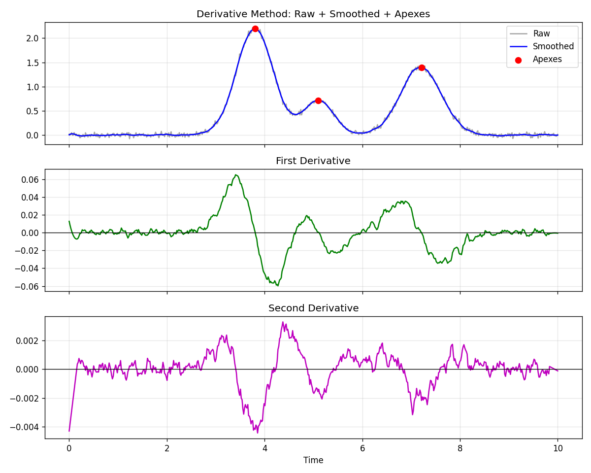
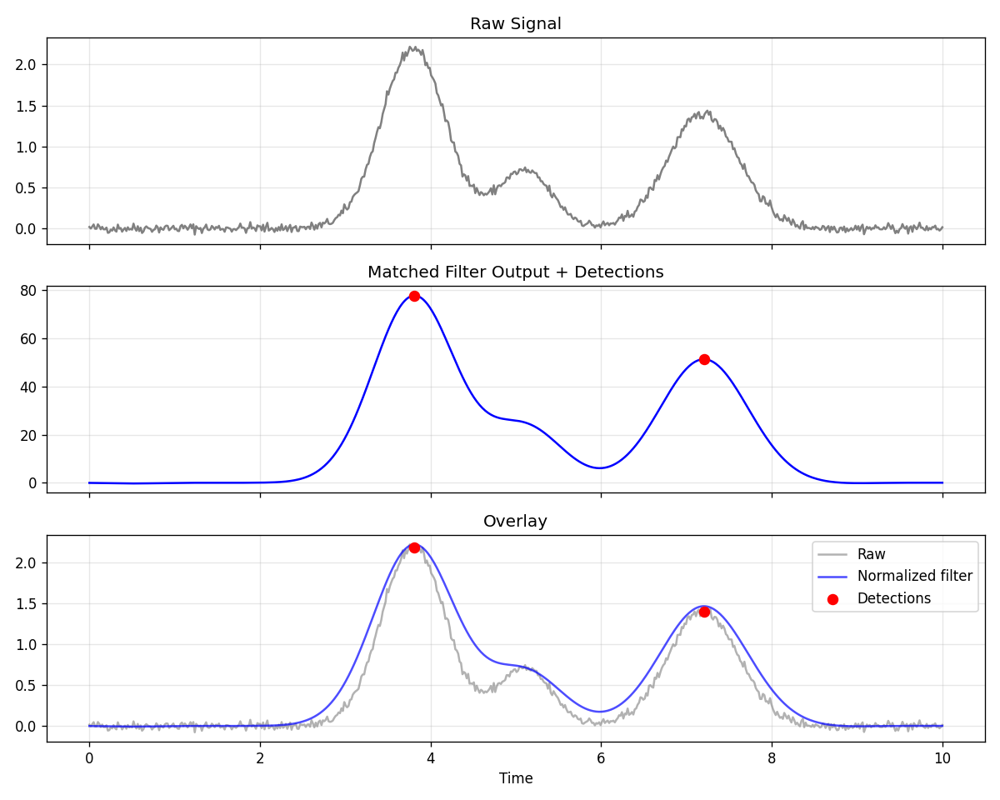
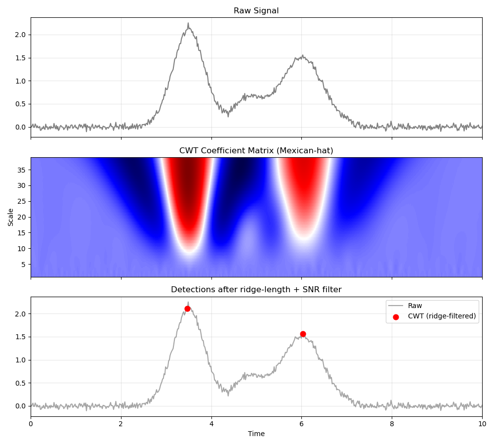
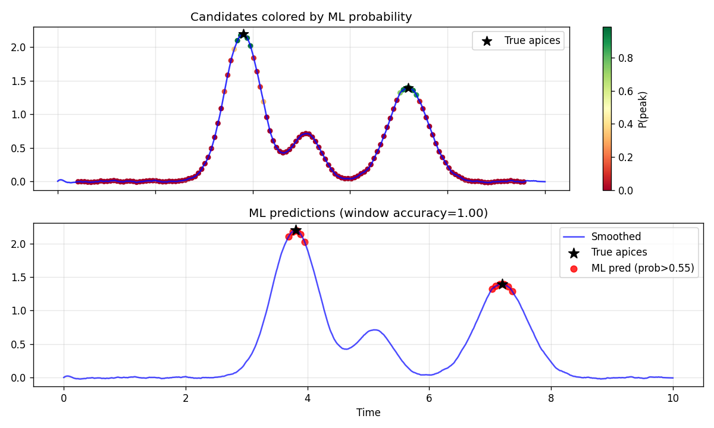

# Peak Detection Methods for Chromatographic and Mass-Spectrometry Data

This note summarizes four common approaches to peak detection, with short explanations, plain-text equations, and example figures. All methods shown here are batch (offline) algorithms that operate on a complete signal.

Figures are in the `peak_detection_figures/` directory.

## 1. Derivative-Based Detection (Savitzky-Golay)

Smooth the signal and compute derivatives with a Savitzky-Golay filter (local polynomial fit).  

- A peak apex corresponds to a positive-to-negative zero-crossing of the first derivative.  
- Negative lobes of the second derivative mark regions of high curvature (peaks or shoulders).  

The first derivative of a smoothed signal y at sample i can be written conceptually as  

d1[i] = sum(c_k * y[i+k])  

where c_k are the Savitzky-Golay derivative coefficients.  

Local maxima of the smoothed signal (or zero-crossings of d1) are then filtered by height, prominence, and minimum distance.

**Notes**  
- Simple and fast; widely used in classical chromatography data systems.  
- Shoulders appear as extra negative lobes in the second derivative that do not produce a first-derivative sign change.  
- Sensitive to the smoothing window length.

## 2. Matched Filtering / Template Matching

Correlate the observed signal with a model peak shape (commonly a Gaussian or the second derivative of a Gaussian). The output is large where the data locally resemble the template.

Discrete cross-correlation (the matched filter):  

filtered[i] = sum_k ( signal[i+k] * template[k] )  

Peaks are then taken as local maxima of the filtered trace that satisfy height and prominence thresholds.

**Notes**  
- Optimal for a known shape in white noise; improves signal-to-noise ratio.  
- Performance drops when the true peak width or shape differs from the template.  
- This is the principle behind the original XCMS matchedFilter algorithm.

## 3. Continuous Wavelet Transform (CWT)

Apply the continuous wavelet transform with a peak-like wavelet (Mexican-hat / Marr wavelet is typical). True peaks produce ridges—continuous lines of local maxima that persist across multiple scales—in the coefficient matrix.

The CWT coefficient at scale s and position b is  

C(s, b) = integral signal(t) * psi_s,b(t) dt  

where psi is the scaled and translated wavelet.  

A practical detector links local maxima across scales into ridges and keeps only ridges that are long enough and exceed a signal-to-noise threshold. The time location of the strongest point on a valid ridge is the reported apex.

**Notes**  
- Naturally multi-scale; robust to noise and baseline.  
- Foundation of centWave (XCMS) and MassSpecWavelet.  
- The bright vertical bands in the coefficient image are the ridges; their centers align with peak locations. Weak peaks produce short, low-contrast ridges visible mainly at fine scales.

## 4. Machine-Learning / Deep-Learning Approaches

Extract features from sliding windows (or from wavelet/ROI representations) and train a classifier to label windows as peak or non-peak. Once trained, the model assigns a probability to each candidate window; windows above a probability threshold are reported as peaks.

In the example a random forest is trained on simple window statistics (max, mean, standard deviation, relative apex location, area). Ground-truth apices are marked with stars; red points are windows whose predicted probability exceeds 0.55.

**Notes**  
- Can learn complex or lab-specific patterns (see Agilent AI Peak Integration for MassHunter).  
- Requires labeled examples.  
- The reported accuracy is window-classification accuracy, not a direct peak-level precision/recall.  
- Hybrid pipelines (classical detector + ML quality filter) are common in practice.

## Quick Comparison

| Method            | Apex criterion                  | Strengths                     | Main limitations                  |
|-------------------|---------------------------------|-------------------------------|-----------------------------------|
| Derivative        | 1st-deriv zero-crossing        | Simple, shoulder-sensitive    | Noise amplification, window choice|
| Matched filter    | Max of correlation             | Optimal SNR for known shape   | Shape/width mismatch              |
| CWT               | Ridge in coefficient matrix    | Multi-scale, robust           | Scale selection, computation      |
| ML / DL           | Classifier probability         | Adaptive, complex patterns    | Needs labels, less transparent    |

## Practical Remarks

- Almost all production pipelines first apply baseline correction and smoothing.  
- `scipy.signal.find_peaks` itself only finds local maxima by neighbor comparison, then applies height / prominence / distance filters; it does not compute a derivative.  
- Real-time (streaming) versions are possible with causal filters or sliding windows, but most chromatographic peak detection is performed in batch after the run finishes.  
- For quantification the detected locations and boundaries are passed to an integration or peak-modeling step that computes area (AUC).

## Dependencies for the example figures

numpy, scipy, matplotlib, pywavelets, scikit-learn
